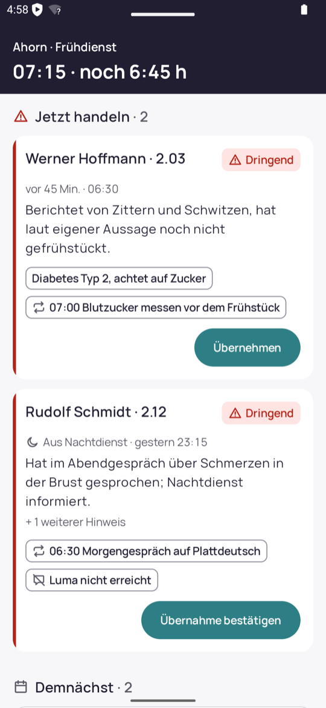
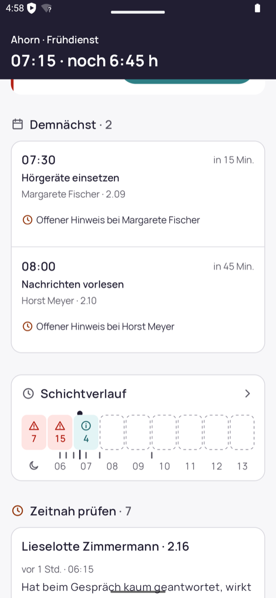
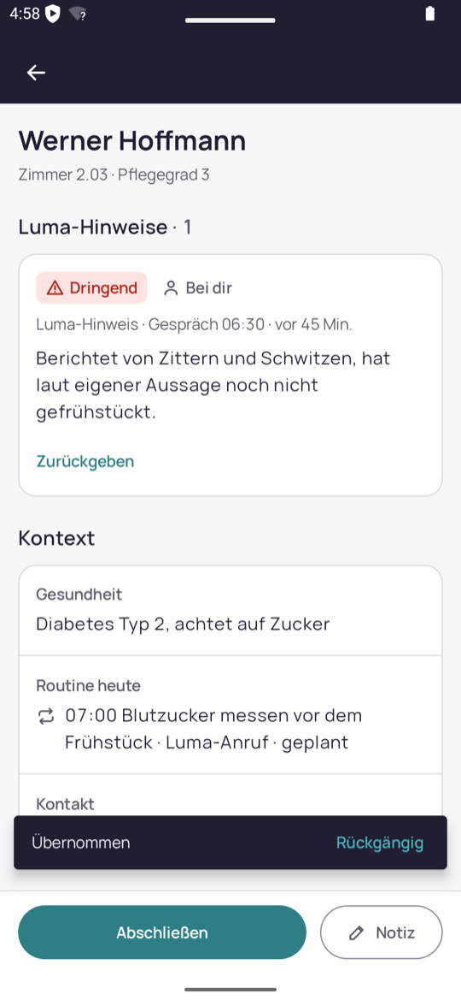
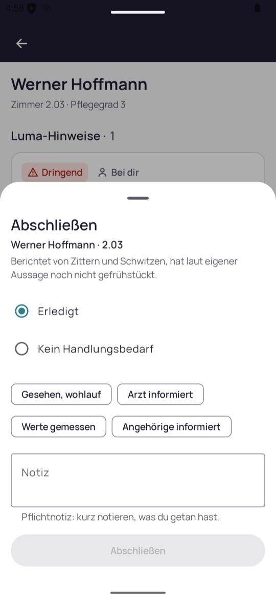
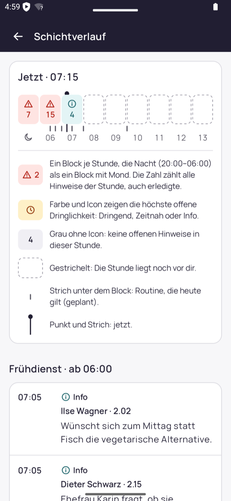
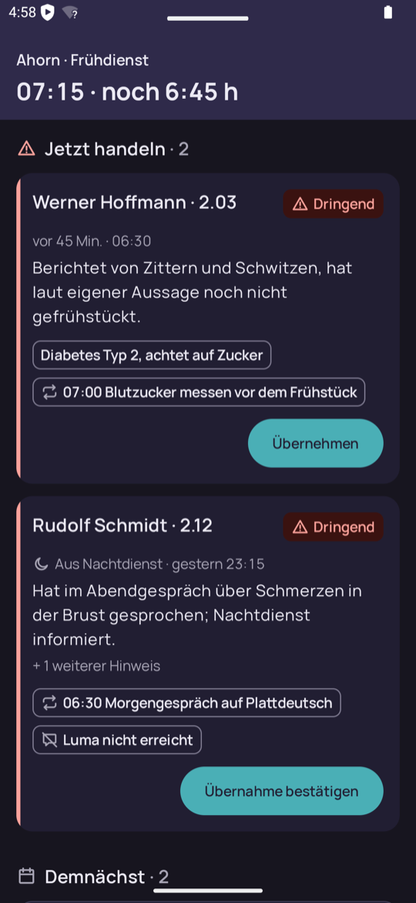
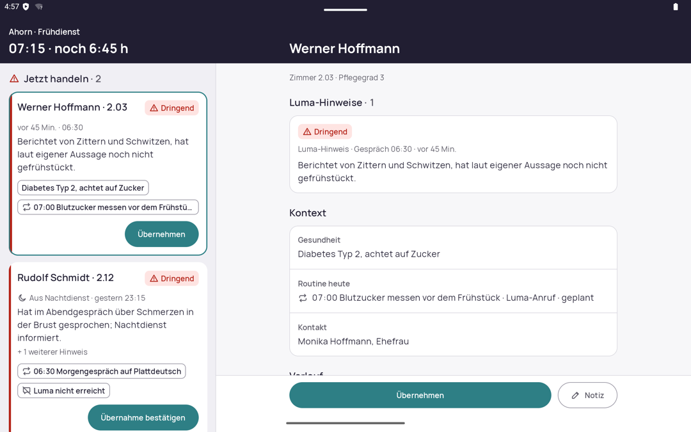

<p align="center">
  <picture>
    <source media="(prefers-color-scheme: dark)" srcset="docs/assets/logo-dark.svg">
    
  </picture>
</p>

<p align="center">
  <strong>Was Luma im Gespräch mit Bewohnenden erfährt, priorisiert für die Pflegefachkraft im Schichtdienst.</strong><br>
  Native Android-App (Kotlin, Jetpack Compose, Room) für Phone und Tablet.
</p>

<p align="center">
  Case Study „Product Builder“ · Luma Life · <!-- STATUS -->Status: Abgabe Case Study
</p>

---

## Executive Summary

Luma spricht täglich mit den Bewohnenden. Bei der Pflegefachkraft kommt davon bisher eine Liste von
Einzelereignissen an, die sie im Gehen nicht sortieren kann. Luma Care beantwortet eine Frage:
**Wer braucht jetzt meine Aufmerksamkeit, und warum?** Die App bündelt die Luma-Hinweise pro Person,
ordnet sie nach Dringlichkeit und zeigt nur den Kontext, den die Daten hergeben (Routine, Aktivität,
Gesundheitsangabe). Der Kern-Flow „Anliegen übernehmen → bearbeiten → abschließen“ schreibt jede
Statusänderung mit Verlauf in die lokale Datenbank und lässt sich rückgängig machen. Leitend sind
drei Prinzipien: Personen statt Events, Dringlichkeit ≠ Zuständigkeit, Hinweis statt Diagnose.

## Screenshots

| Dashboard | Schichtverlauf auf dem Dashboard | Detail nach „Übernehmen“ |
|---|---|---|
|  |  |  |
| **Abschließen mit Pflichtnotiz** | **Schichtverlauf** | **Dark Mode** |
|  |  |  |



*Tablet: Dashboard und Personendetail nebeneinander (List-Detail).*

## Funktionen

- **Dashboard** mit Schichtkopf (Wohnbereich, Dienst, Uhrzeit, Restzeit) und den Abschnitten
  *Jetzt handeln* (offene dringende Hinweise), *Demnächst* (Routinen und Aktivitäten der nächsten
  60 Minuten), *Schichtverlauf* (Stundenblöcke: Nacht als ein Block, danach je Stunde),
  *Zeitnah prüfen* und *Organisatorisches*. Ist nichts mehr offen, zeigt der leere Zustand den Schichtverlauf und *In dieser Schicht erledigt*.
  Eine Personenkarte zeigt den maßgeblichen Hinweis, höchstens zwei Kontext-Chips und eine Schnellaktion.
- **Zustände:** Laden, „Alles erledigt“ (erst nach dem Import), Fehler mit „Erneut versuchen“.
- **Schichtverlauf-Screen:** chronologische Liste, gruppiert nach Frühdienst und Vorschicht, mit Legende.
- **Personendetail:** offene Luma-Hinweise mit Originalaussage, Kontext (Gesundheit, Routine heute,
  Aktivität, Kontakt, Vorlieben, Biografie) und Personenverlauf.
- **Kern-Flow** pro Hinweis: *Übernehmen*, *Übernahme bestätigen* (Fälle aus dem Nachtdienst),
  *Notiz* mit Textbausteinen und Freitext, *Zurückgeben*, *Abschließen* (Erledigt, Kein
  Handlungsbedarf; Pflichtnotiz bei dringenden und Gesundheitshinweisen), *Weiterleiten* an Küche,
  Haustechnik, Sozialdienst oder Verwaltung, *Zur Kenntnis* für Info-Hinweise, *Rückgängig* über die Snackbar.
  Die Regeln stehen in [Planung §5](docs/00-planung.md).
- **Tablet:** ab 840 dp Breite List-Detail (Dashboard links auf getönter Fläche, Detail rechts, beim Start die oberste Person geöffnet), darunter eine Spalte.
- **Dark Mode** über die Systemeinstellung; Layouts wachsen mit großer Schrift (Previews mit 200 %).
- **Nicht umgesetzt:** Kennzahlen-Zeile (entfällt, bis es Filter gibt), zweiter Flow, LLM-Call,
  Backend. Siehe [Roadmap](docs/01-entscheidungen.md#roadmap).

## Starten

**Voraussetzungen:** Android Studio Rabbit 1 (2026.2.1) oder neuer. Das JDK 25 für den Build bezieht
Gradle über die Daemon-JVM-Konfiguration (`gradle/gradle-daemon-jvm.properties`) automatisch.
Für `./gradlew` im Terminal genügt ein lokales JDK ab 17 (z. B. die JBR von Android Studio).
Ziel: ab Android 8.0 (minSdk 26), targetSdk 37, Phone und Tablet.

```sh
./gradlew installDebug         # auf laufendem Emulator oder Gerät installieren
```

**Erster Start:** Die App importiert `docs/case/luma-seed.json` (als App-Asset gebündelt) in einer
Transaktion in die lokale Room-Datenbank. Danach arbeitet sie nur mit der Datenbank.

**Uhr:** „Jetzt“ beginnt beim Seed-Zeitpunkt **Mo, 12.10.2026, 07:15** und läuft ab dem ersten Start
in Echtzeit mit, auch über Neustarts hinweg. Nach 14:00 zeigt der Kopf „Schicht beendet“.
Zurücksetzen auf 07:15 und den Ausgangszustand der Daten: in den Android-Einstellungen bei
„Luma Care“ die App-Daten löschen, oder:

```sh
adb shell pm clear com.mulkatz.lumacare
```

## Prüfen

```sh
./gradlew assembleDebug testDebugUnitTest lint
```

Alle Tests laufen auf der JVM, ohne Emulator (Robolectric). Insgesamt 166 Tests:

| Art | Was |
|---|---|
| Unit (Domain) | Prioritizer, EventTransitions, ShiftClock, ShiftHours, PersonDetail, Verlauf |
| Room in-memory | Seed-Import (vollständig, transaktional, fehlerhafte Daten), Schreibpfad mit bedingtem Update und Undo, Migration v1 → v2 |
| Compose-UI unter Robolectric | Dashboard, Detail, Schichtverlauf, Aktionen, Insets; Phone (411 × 891 dp) und Tablet (1280 × 800 dp) |
| End-to-End | `CoreFlowE2ETest`: Start → Import → Werner unter *Jetzt handeln* → Detail → Übernehmen → Notiz → Abschließen mit Pflichtnotiz → Rückgängig → erneut abschließen → Werner nicht mehr unter *Jetzt handeln* → Activity neu erzeugen → Zustand bleibt; auf Phone und Tablet |

## Architektur

```
app/src/main/java/com/mulkatz/lumacare/
  data/     local (Room: Entities, DAOs, Migration) · seed (Parser, Importer) · repository
  domain/   Prioritizer · EventTransitions · ShiftClock · PersonDetail · ShiftHours · ShiftHistory
  ui/       theme (Tokens) · components · dashboard · detail · history · actions
  AppContainer.kt   manuelle DI, kein Hilt/Koin
```

- **Ein Modul, drei Schichten:** `data` → `domain` → `ui`. Die UI kennt nur Repositories und Domain-Modelle.
- **Statuswechsel:** Die UI übergibt den Zustand, den sie gesehen hat (optimistisches Sperren).
  `EventTransitions` prüft den Übergang und die Pflichtnotiz; das DAO schreibt mit bedingtem Update
  (`WHERE status = :expected`). Ein veralteter Zustand ergibt „Wurde inzwischen geändert“ statt
  eines Verlaufseintrags.
- **Verlauf und Undo:** Jede Aktion schreibt in derselben Transaktion eine Zeile in `event_action`
  mit dem vorherigen Zustand. Rückgängig stellt ihn her und entfernt die Aktion.
- **Zeit:** „Jetzt“ kommt nur aus der `ShiftClock`; zeitabhängige Ansichten aktualisieren sich jede Minute.

Begründungen und Datenmodell: [docs/01-entscheidungen.md](docs/01-entscheidungen.md).

## Dokumentation

| Dokument | Inhalt |
|---|---|
| [Planung](docs/00-planung.md) | Analyse, Produktkonzept, Flow-Regeln, Designsystem, Architektur, Teststrategie, Zeitplan |
| [Entscheidungen](docs/01-entscheidungen.md) | Produkt und UX, Annahmen, Datenmodell, Kanalstrategie, Roadmap |
| [KI-Arbeitsweise](docs/02-ki-arbeitsweise.md) | Steuerung mit Claude Code, Korrekturmomente, Zeitprotokoll |
| [Zielbild](docs/zielbild/zielbild.html) | Statisches HTML-Zielbild v2 (im Browser öffnen); v1 liegt in der Git-Historie |
| [CLAUDE.md](CLAUDE.md) · [.claude/](.claude/) | Projekt-Instruktionen, Skills und Agenten für Claude Code |
| [Aufgabenstellung](docs/case/case-study.md) | Original-Case inkl. [Seed-Daten](docs/case/luma-seed.json) |

## Bekannte Grenzen

- Alle Daten sind fiktiv und stammen aus dem Seed.
- Keine Anmeldung: Der Verlauf nennt die Schicht, keine Namen.
- Keine Synchronisation zwischen Geräten; Weiterleiten wird nur gespeichert und angezeigt.
- Ein CI-Workflow (`.github/workflows/ci.yml`) ist vorhanden. Seine Läufe waren zeitweise durch das
  GitHub-Actions-Budget blockiert (Abrechnung, nicht der Code).
<!-- GRENZEN -->

## Lizenz

Alle Rechte vorbehalten, Details und Inhalte Dritter siehe [LICENSE](LICENSE).
Die Schrift Manrope steht unter der SIL Open Font License, siehe [docs/licenses/](docs/licenses/).
Alle Personen- und Gesundheitsdaten sind fiktiv.
